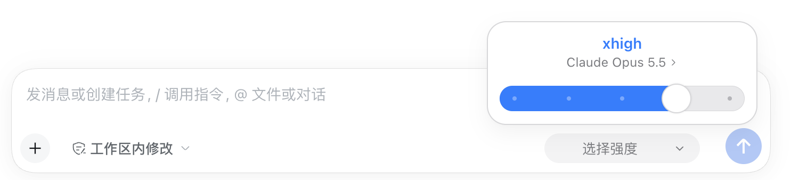
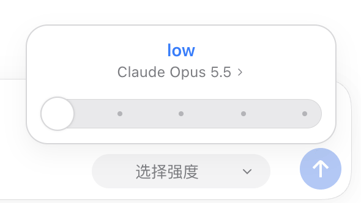
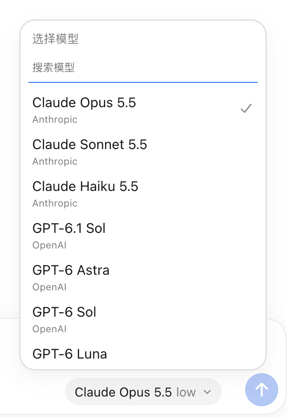
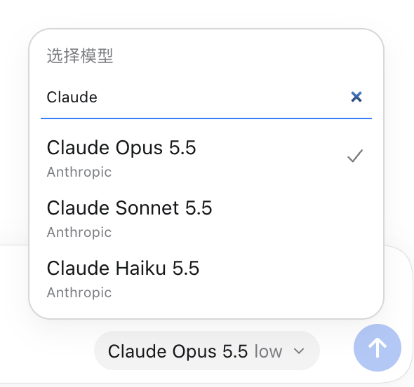
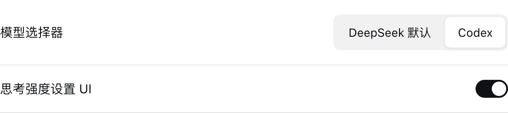
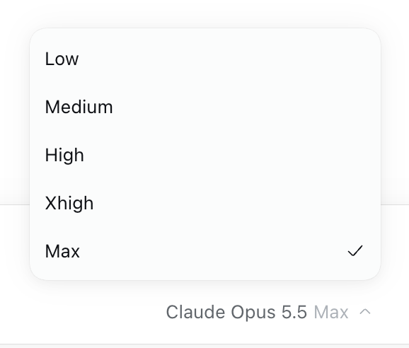
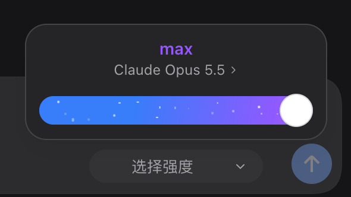

<div align="center">

# DSH Model Efforts

为 [DeepSeek Harness](https://github.com/deepseek-ai/deepseek-harness) 添加模型思考强度管理与 Codex 风格选择器。

[](https://github.com/deepseek-harness-plugins/dsh-model-efforts)
[](docs/VERIFICATION.md)
[](LICENSE)

[界面预览](#界面预览) · [安装](#安装) · [使用](#使用) · [模型目录](docs/MODEL-CATALOG.md) · [贡献](#贡献)

</div>

<p align="center">
  
</p>

## 界面预览

### 用滑杆切换思考强度

点击输入框中的模型名称，直接点击档位或拖动滑块。最高可用档位显示渐变与粒子效果，档位名称保留模型原有的英文值。

<p align="center">
  
</p>

### 在同一菜单中切换模型

点击滑杆面板中的模型名称进入模型列表，选中支持思考强度的模型后回到滑杆面板。模型下方显示所属渠道，较长的列表支持搜索。

<table>
  <tr>
    <th>模型与渠道</th>
    <th>搜索模型</th>
  </tr>
  <tr>
    <td align="center"></td>
    <td align="center"></td>
  </tr>
</table>

### 在模型设置中管理档位

思考强度设置位于模型的上下文窗口与最大输出设置下方。输入模型 ID 后自动匹配支持的档位，也可以添加、删除档位，点击标签内的 **设为默认** 指定默认强度。

<p align="center">
  
</p>

### 选择自己习惯的界面

在 **设置 → 通用设置** 中切换 **DeepSeek 默认 / Codex**，并独立开启或关闭模型编辑器中的思考强度设置 UI。

<p align="center">
  
</p>

<table>
  <tr>
    <th>DeepSeek 默认</th>
    <th>Codex · 深色主题</th>
  </tr>
  <tr>
    <td align="center"></td>
    <td align="center"></td>
  </tr>
</table>

## 安装

需要 Node.js **≥ 22.19.0**，已验证的 DSH 版本为 **0.2.0-rc.2**。

```sh
git clone https://github.com/deepseek-harness-plugins/dsh-model-efforts.git
cd dsh-model-efforts
npm ci
npm run build
npm pack
```

打开 DSH 的 **插件 → 添加插件**，输入生成的 `.tgz` 安装包的绝对路径，安装并启用插件。

升级时安装新版同名安装包，保存正在编辑的内容并重启 DSH。

## 使用

| 入口 | 用途 |
| --- | --- |
| 设置 → 通用设置 → 模型选择器 | 在 DeepSeek 原生菜单与 Codex 滑杆之间切换；首次安装使用 DeepSeek 默认样式。 |
| 设置 → 通用设置 → 思考强度设置 UI | 控制模型编辑器中档位设置的显示，关闭后已保存的配置继续生效。 |
| 设置 → 模型 → 编辑服务商 → 展开模型 | 自动匹配档位、增删档位及设置默认强度，最后使用原生 **保存 / 取消** 处理修改。 |
| 聊天输入框 → 模型名称 | 为当前会话切换模型和思考强度，手动选择的档位优先于模型默认值。 |

**自动匹配**依据模型 ID、API 协议和适用端点。打开服务商编辑器时，保留已有自定义配置，并补齐尚未配置档位的已收录模型；修改模型 ID 后匹配新模型。**自动匹配** 按钮用于恢复目录预设，**重置** 恢复本次编辑前的配置。

**`off` 与 `Default` 含义不同。** `off` 明确关闭思考，仅在模型支持时提供；`Default` 沿用宿主默认行为。最高档位动画使用模型实际支持的档位，不额外添加 `Ultra`。

行内档位编辑器支持 Pi AI 自定义渠道。内置 DeepSeek 渠道使用宿主提供的档位，直接通过聊天选择器切换。

## 模型支持

内置目录收录 **83 个模型 ID、42 条协议规则**，覆盖 Anthropic、OpenAI、Google、DeepSeek、Qwen、xAI，以及 QwenCloud 托管的 GLM 与 Kimi。

每条规则包含支持档位、协议和官方文档来源。完整列表见 [模型目录](docs/MODEL-CATALOG.md)，宿主兼容范围与测试说明见 [验证记录](docs/VERIFICATION.md)。第三方网关需要支持并透传对应的思考参数。

## 开发

```sh
npm ci
npm run build     # 构建插件
npm test          # 逻辑测试
npm run test:ui   # DSH 页面与交互测试
npm run check    # 执行全部检查
```

页面测试使用隔离的 DSH web profile 和本地模拟服务，需要已安装的 DSH CLI 与 Chrome。可通过 `DME_CLI` 指定 CLI 路径，通过 `DME_BROWSER` 指定 Playwright 浏览器通道。

## 贡献

欢迎通过 [Issue](https://github.com/deepseek-harness-plugins/dsh-model-efforts/issues) 反馈问题，或提交 Pull Request。

新增模型规则时，请在 `src/catalog.js` 中填写明确的模型 ID、支持档位、API 协议及官方文档来源，再更新目录文档：

```sh
node scripts/catalog-doc.mjs
```

行为变更请补充相应测试，提交信息遵循 [Conventional Commits](https://www.conventionalcommits.org/zh-hans/v1.0.0/)。

## 许可证

[MIT](LICENSE)
