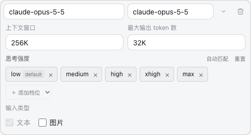

<div align="center">

# DSH Model Efforts

在 [DeepSeek Harness](https://github.com/deepseek-ai/deepseek-harness) 的原生模型设置中管理思考强度与默认档位。

[](https://github.com/deepseek-harness-plugins/dsh-model-efforts)
[](docs/VERIFICATION.md)
[](LICENSE)

[界面预览](#界面预览) · [安装](#安装) · [使用](#使用) · [模型目录](docs/MODEL-CATALOG.md) · [贡献](#贡献)

</div>

<p align="center">
  
</p>

## 界面预览

### 自动匹配模型支持的档位

思考强度设置位于模型的上下文窗口与最大输出设置下方。输入完整模型 ID 后自动匹配官方目录，也可以添加、删除档位，点击标签内的 **设为默认** 指定默认强度。

已配置的模型保留自定义档位。**自动匹配** 恢复目录预设，**重置** 恢复本次编辑前的配置；所有修改通过 DSH 原生的 **保存 / 取消** 处理。

### 按需显示设置 UI

在 **设置 → 通用设置** 中开启或关闭思考强度设置 UI。关闭 UI 后，已保存的模型档位与默认值继续生效。

<p align="center">
  
</p>

## 安装

在 DSH 插件列表中显示为「模型思考强度」。

需要 Node.js **≥ 22.19.0**，已验证的 DSH 版本为 **0.2.0-rc.2**。

```sh
git clone https://github.com/deepseek-harness-plugins/dsh-model-efforts.git
cd dsh-model-efforts
npm ci
npm run build
npm pack
```

打开 DSH 的 **插件 → 添加插件**，输入生成的 `.tgz` 安装包的绝对路径，安装并启用插件。升级时安装新版同名安装包，保存正在编辑的内容并重启 DSH。

从 0.5.0 起，Codex 风格选择器由独立的 [DSH Codex Picker](https://github.com/deepseek-harness-plugins/dsh-codex-picker) 提供。两个插件均可单独安装；一起安装时，选择器会读取这里配置的档位。

## 使用

| 入口 | 用途 |
| --- | --- |
| 设置 → 模型 → 编辑服务商 → 展开模型 | 自动匹配、增删档位与设置默认强度。 |
| 设置 → 通用设置 → 思考强度设置 UI | 控制行内档位设置的显示。 |
| 聊天输入框 → 模型名称 → 推理等级 | 使用 DSH 原生菜单选择当前会话的强度，显式选择优先于模型默认值。 |

自动匹配依据明确的模型 ID、API 协议和适用端点。打开编辑器时补齐尚未配置档位的已收录模型；修改模型 ID 后匹配新模型。未收录的 ID 可以手动配置档位。

**`off` 明确关闭思考，`Default` 沿用宿主默认行为。** 仅在模型支持完全关闭时提供 `off`；档位中的 `default` 标签标记默认强度，它本身不是额外档位。

行内编辑器支持 Pi AI 自定义渠道。内置 DeepSeek 渠道使用 DSH 提供的档位，通过聊天选择器切换。

## 模型支持

内置目录收录 **83 个模型 ID、42 条协议规则**，覆盖 Anthropic、OpenAI、Google、DeepSeek、Qwen、xAI，以及 QwenCloud 托管的 GLM 与 Kimi。

每条规则附支持档位、API 协议和官方文档来源。完整列表见 [模型目录](docs/MODEL-CATALOG.md)，兼容范围与测试说明见 [验证记录](docs/VERIFICATION.md)。第三方网关需要透传对应的思考参数。

## 开发

```sh
npm ci
npm run build     # 构建插件
npm test          # 目录、默认值和偏好测试
npm run test:ui   # 在隔离 DSH profile 中验证模型编辑和请求
npm run check    # 执行全部检查
```

页面测试使用本地模拟 Anthropic 服务，需要已安装的 DSH CLI 与 Chrome。可通过 `DME_CLI` 指定 CLI 路径，通过 `DME_BROWSER` 指定 Playwright 浏览器通道。

## 贡献

欢迎通过 [Issue](https://github.com/deepseek-harness-plugins/dsh-model-efforts/issues) 反馈问题，或提交 Pull Request。

新增规则请在 `src/catalog.js` 中填写明确模型 ID、支持档位、协议及官方来源，再更新模型目录：

```sh
node scripts/catalog-doc.mjs
```

行为变更请补充相应测试。提交信息遵循 [Conventional Commits](https://www.conventionalcommits.org/zh-hans/v1.0.0/)，仓库维护约定见 [AGENTS.md](AGENTS.md)。

## 许可证

[MIT](LICENSE)
