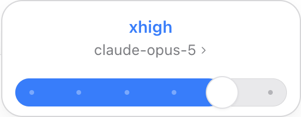
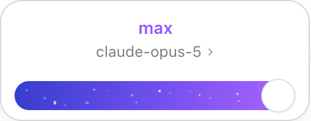

# DSH Model Efforts

[DeepSeek Harness](https://github.com/deepseek-ai/deepseek-harness) 的模型与思考强度插件。支持管理模型档位、自动匹配官方模型能力，以及切换聊天输入框的模型选择器样式。


## 功能

- 提供 DeepSeek 原生和 Codex 滑杆两种模型选择器样式。
- Codex 滑杆在最高可用档位显示紫色粒子动画，保持模型原有档位名称。
- 在通用设置中选择样式，开启或关闭模型编辑器内的思考强度设置 UI。
- 在模型的上下文窗口和最大输出设置下方编辑思考强度。
- 添加、删除档位，保留 `off`、`low`、`medium`、`high` 等原始英文值。
- 输入或修改模型 ID 后，根据 API 协议自动匹配支持的档位。
- 打开服务商编辑器时，自动补齐已收录且尚未配置档位的模型。
- 非默认档位的标签内显示 **设为默认** 按钮，当前默认档位显示 `default` 标签。
- 重置编辑内容，使用原生服务商编辑器统一保存或取消。

## 安装

要求：Node.js ≥ 22.19.0。已验证的宿主版本为 DSH 0.2.0-rc.2。

从源码构建：

```sh
git clone https://github.com/deepseek-harness-plugins/dsh-model-efforts.git
cd dsh-model-efforts
npm ci
npm run build
npm pack
```

在 DSH 的 **插件 → 添加插件** 中输入生成的 `deepseekharness-plugin-dsh-model-efforts-0.4.3.tgz` 的绝对路径，安装后启用插件。

升级时安装新版同名安装包，保存正在编辑的内容后重新启动 DSH，加载新版客户端。

## 使用

### 选择器样式

打开 **设置 → 通用设置**，选择模型选择器样式。设置立即生效，并保存在当前客户端。

| 样式 | 操作方式 |
| --- | --- |
| DeepSeek 默认 | 使用宿主原生的模型与推理等级菜单，首次安装默认选择此样式。 |
| Codex | 点击输入框中的模型名称，拖动滑杆调整思考强度；点击面板内的模型名称切换模型。 |

<p>
  
  
</p>

Codex 选择器读取 DSH 模型目录中实际配置的档位，使用原生会话模型切换接口。档位名称直接显示英文值。最高档位的动画是一种视觉效果，不会增加 `Ultra` 档位。

选择器包含面板展开、菜单切换、档位标签和滑杆吸附动画，支持键盘操作、模型搜索、深色主题和减少动态效果。模型目录较长时显示搜索框；模型菜单最高 360px，标题和搜索框固定，各模型下方显示所属渠道。列表可滚动，但不显示滚动条；滑杆面板的档位与模型名称使用统一的悬停背景。未配置思考能力的模型只显示模型列表。

### 编辑模型档位

1. 打开 **设置 → 模型**，编辑自定义服务商并展开模型选项。
2. 已收录且尚未配置档位的模型会自动填入支持的档位；输入或修改模型 ID 后也会自动匹配。未收录的模型可以手动添加档位；**自动匹配** 按钮可恢复目录预设。
3. 点击档位标签内的 **设为默认** 按钮，将该档位设为默认。当前默认档位显示 `default` 标签，不显示该按钮。
4. 使用 **添加档位** 或标签右侧的 **×** 调整可用档位。**重置** 恢复本次编辑前的设置。
5. 点击服务商编辑器的 **保存** 应用修改，或点击 **取消** 放弃修改。

**设置 → 通用设置 → 思考强度设置 UI** 控制此编辑界面的显示。关闭后，已经保存的模型档位和默认值继续生效。

行内档位编辑器用于 Pi AI 自定义渠道。内置 DeepSeek 渠道由宿主提供 `off / low / high / max`，直接在聊天选择器中切换；其模型配置不支持自定义档位字段，因此不显示档位增删 UI。

### 自动匹配

打开服务商编辑器时，尚未配置档位和默认值的已收录模型会自动匹配，折叠的模型也会处理。已有档位、默认值或明确清空的配置保持原样。

模型 ID 实际改变后，停止输入或离开输入框即触发匹配。修改显示名称、容量，或重新输入相同 ID，均保留已调整的档位和默认值。**重置** 恢复本次编辑前的配置，在本次编辑中不会再次自动填回；重新打开编辑器时，未配置的模型仍会自动匹配。删除全部档位后保存，模型保持明确清空的状态。匹配结果写入编辑草稿，使用原生 **保存** 或 **取消** 处理。

### 默认档位

会话中手动选择的档位优先于模型默认档位。模型配置了默认档位后，聊天菜单直接使用具体档位；未设置默认值的模型沿用 DSH 的默认行为。

`off` 表示关闭思考，与表示默认行为的 `Default` 不同。只有支持关闭思考的匹配规则才提供 `off`。

Claude 的关闭能力按具体模型匹配。Opus 4.6 / 4.7 / 4.8 / 5、Sonnet 4.6 / 5 和 Haiku 5.5 提供 `off`；Opus 5.5、Fable、Mythos 和 Sonnet 5.5 不提供完全关闭选项。Sonnet 5.5 的 `between_tools` 只关闭前置思考，不标为 `off`。能力依据 [Anthropic 官方配置表](https://platform.claude.com/docs/en/build-with-claude/thinking#configuring-thinking)。

在 Anthropic Messages 协议下，`off` 发送 `thinking.type = "disabled"`，不附 `output_config.effort`，避免 Opus 5 和 Haiku 5.5 的关闭请求与 `xhigh` / `max` 冲突。已有模型可点击 **自动匹配** 并保存，使用更新后的档位列表。

自动匹配优先将 `high` 设为默认，其次为 `medium`，否则选择一个支持的思考档位。此选择是插件的预设策略，可以在界面修改。删除当前默认档位会重新选择；删除全部档位会同时清除默认值。

## 模型支持

模型目录包含 83 个模型 ID、42 条协议规则，覆盖 Anthropic、OpenAI、Google、DeepSeek、Qwen、xAI，以及 QwenCloud 托管的 GLM 和 Kimi。目录核对日期为 2026-10-12。

自动匹配依据模型 ID、API 协议和适用端点。完整档位列表及官方来源见 [模型目录](docs/MODEL-CATALOG.md)。

第三方网关需要支持并透传对应的思考参数。宿主升级后，应重新验证模型编辑器和请求适配的兼容性。

## 开发

```sh
npm ci
npm run build     # 构建插件
npm test          # 运行逻辑测试
npm run test:ui   # 运行 DSH 页面测试
npm run check    # 执行全部检查
```

页面测试需要已安装的 DSH CLI 和 Chrome，运行于隔离的 web profile，并使用本地模拟服务验证请求参数。默认使用 macOS 应用内的 CLI；可通过 `DME_CLI` 指定其他 CLI 路径，通过 `DME_BROWSER` 指定 Playwright 浏览器通道。

验证范围和兼容性说明见 [验证记录](docs/VERIFICATION.md)。

## 贡献

欢迎通过 [Issue](https://github.com/deepseek-harness-plugins/dsh-model-efforts/issues) 报告问题或提交 Pull Request。

新增模型规则时，请在 `src/catalog.js` 中提供准确的模型 ID、支持档位、API 协议和官方文档来源，并生成目录文档：

```sh
node scripts/catalog-doc.mjs
```

行为变更请补充相应测试，并使用约定式提交信息。

## 许可证

[MIT](LICENSE)
